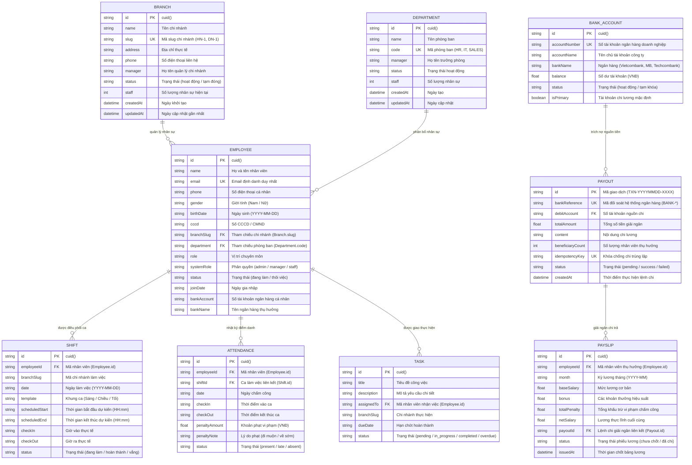

# BÁO CÁO THIẾT KẾ CƠ SỞ DỮ LIỆU QUAN HỆ (ERD) & TỪ ĐIỂN DỮ LIỆU
## DỰ ÁN: HỆ THỐNG QUẢN TRỊ NHÂN SỰ & VẬN HÀNH DOANH NGHIỆP (HRM ENTERPRISE)
**Môn học:** Quản lý dự án phần mềm (QLDAPM) — Nhóm 12 (Lớp N23CQCNPM01-N)  
**Nhiệm vụ Trello:** Tuần 7 — Thiết kế cơ sở dữ liệu quan hệ (ERD) & Đặc tả WSDL SOAP ngân hàng  
**Người thực hiện:** Phạm Văn Đoàn (Thành viên B)  
**Ngày hoàn thành:** 24/10/2026  

---

## 1. TỔNG QUAN KIẾN TRÚC DỮ LIỆU

Hệ thống HRM Enterprise áp dụng mô hình **Database-per-Service** (mỗi microservice sở hữu một cơ sở dữ liệu độc lập) nhằm bảo đảm tính tự chủ, bảo mật phân quyền và khả năng mở rộng. 

Cơ sở dữ liệu sử dụng hệ quản trị **PostgreSQL** kết hợp ORM **Prisma**. Các phân hệ dữ liệu chính bao gồm:

```text
┌────────────────────────────────────────────────────────────────────────┐
│                        HỆ THỐNG HRM ENTERPRISE                         │
├─────────────────────┬───────────────────────────┬──────────────────────┤
│ 1. Organization DB  │ 2. Payroll DB             │ 3. Work DB           │
│ (hrm_organization)  │ (hrm_payroll)             │ (hrm_work)           │
│ Port: 4002          │ Port: 4004                │ Port: 4003           │
├─────────────────────┼───────────────────────────┼──────────────────────┤
│ • branches          │ • bank_accounts           │ • shifts             │
│ • departments       │ • payouts                 │ • attendances        │
│ • employees         │ • payslips                │ • tasks              │
└─────────────────────┴───────────────────────────┴──────────────────────┘
```

> **Nguyên tắc toàn vẹn:**
> - Các service không truy vấn trực tiếp DB của nhau (No cross-database queries).
> - Dữ liệu liên kết giữa các service sử dụng các khóa logic chuẩn: `employeeId`, `branchSlug`, `payoutId`.

---

## 2. SƠ ĐỒ THỰC THỂ QUAN HỆ TỔNG THỂ (GLOBAL ERD)



---

## 3. TỪ ĐIỂN DỮ LIỆU CHI TIẾT (DATA DICTIONARY)

### 3.1. Phân hệ Cơ cấu tổ chức (Organization Service — DB: `hrm_organization`)

#### Bảng: `branches` (Danh mục Chi nhánh doanh nghiệp)
| Tên cột | Kiểu dữ liệu | Ràng buộc | Giá trị mặc định | Mô tả nghiệp vụ |
|---|---|---|---|---|
| `id` | VARCHAR(30) | **PRIMARY KEY** | `cuid()` | Khóa chính duy nhất của bản ghi chi nhánh |
| `name` | VARCHAR(100) | NOT NULL | - | Tên chi nhánh (VD: Chi nhánh Hà Nội 1) |
| `slug` | VARCHAR(50) | **UNIQUE**, NOT NULL | - | Mã định danh dạng URL/Mã nội bộ (VD: `HN-1`, `DN-1`) |
| `address` | VARCHAR(255) | NULL | - | Địa chỉ trụ sở văn phòng/cửa hàng chi nhánh |
| `phone` | VARCHAR(20) | NULL | - | Số điện thoại liên hệ chính thức của chi nhánh |
| `manager` | VARCHAR(100) | NULL | - | Họ tên hoặc mã quản lý trưởng chi nhánh |
| `status` | VARCHAR(30) | NOT NULL | `'hoạt động'` | Tình trạng: `'hoạt động'` hoặc `'tạm đóng'` |
| `staff` | INTEGER | NOT NULL | `0` | Tổng số lượng nhân viên đang công tác tại chi nhánh |
| `createdAt` | TIMESTAMP | NOT NULL | `NOW()` | Thời gian tạo chi nhánh |
| `updatedAt` | TIMESTAMP | NOT NULL | `AUTO UPDATE` | Thời gian cập nhật thông tin chi nhánh gần nhất |

#### Bảng: `departments` (Danh mục Phòng ban)
| Tên cột | Kiểu dữ liệu | Ràng buộc | Giá trị mặc định | Mô tả nghiệp vụ |
|---|---|---|---|---|
| `id` | VARCHAR(30) | **PRIMARY KEY** | `cuid()` | Khóa chính phòng ban |
| `name` | VARCHAR(100) | NOT NULL | - | Tên phòng ban (VD: Phòng Nhân sự, Kế toán) |
| `code` | VARCHAR(50) | **UNIQUE**, NOT NULL | - | Mã viết tắt phòng ban (VD: `HR`, `IT`, `ACC`) |
| `manager` | VARCHAR(100) | NULL | - | Họ tên người phụ trách/Trưởng bộ phận |
| `status` | VARCHAR(30) | NOT NULL | `'hoạt động'` | Tình trạng: `'hoạt động'` hoặc `'giải thể'` |
| `staff` | INTEGER | NOT NULL | `0` | Số lượng nhân viên trực thuộc phòng ban |
| `createdAt` | TIMESTAMP | NOT NULL | `NOW()` | Thời gian tạo bản ghi |
| `updatedAt` | TIMESTAMP | NOT NULL | `AUTO UPDATE` | Thời gian cập nhật bản ghi |

#### Bảng: `employees` (Hồ sơ Nhân sự)
| Tên cột | Kiểu dữ liệu | Ràng buộc | Giá trị mặc định | Mô tả nghiệp vụ |
|---|---|---|---|---|
| `id` | VARCHAR(30) | **PRIMARY KEY** | `cuid()` | Khóa chính mã định danh nhân viên |
| `name` | VARCHAR(100) | NOT NULL | - | Họ và tên đầy đủ của nhân sự |
| `email` | VARCHAR(100) | **UNIQUE**, NOT NULL | - | Email làm việc chính thức (dùng để đăng nhập) |
| `phone` | VARCHAR(20) | NULL | - | Số điện thoại liên lạc cá nhân |
| `gender` | VARCHAR(10) | NULL | - | Giới tính: Nam / Nữ / Khác |
| `birthDate` | VARCHAR(20) | NULL | - | Ngày tháng năm sinh định dạng `YYYY-MM-DD` |
| `province` | VARCHAR(100) | NULL | - | Tỉnh / Thành phố thường trú |
| `ward` | VARCHAR(100) | NULL | - | Phường / Xã thường trú |
| `street` | VARCHAR(255) | NULL | - | Địa chỉ số nhà, tên đường |
| `cccd` | VARCHAR(20) | NULL | - | Số CCCD / Hộ chiếu |
| `branchSlug` | VARCHAR(50) | NULL | - | Chi nhánh đang làm việc (Khóa logic tới `branches.slug`) |
| `department` | VARCHAR(50) | NULL | - | Phòng ban trực thuộc (Khóa logic tới `departments.code`) |
| `role` | VARCHAR(100) | NULL | - | Chức danh công việc (VD: Nhân viên pha chế, Kế toán viên) |
| `systemRole` | VARCHAR(20) | NOT NULL | `'staff'` | Quyền hệ thống: `'admin'`, `'manager'`, `'staff'` |
| `status` | VARCHAR(30) | NOT NULL | `'đang làm'` | Tình trạng lao động: `'đang làm'`, `'thôi việc'` |
| `joinDate` | VARCHAR(20) | NULL | - | Ngày ký hợp đồng chính thức bắt đầu làm việc |
| `createdAt` | TIMESTAMP | NOT NULL | `NOW()` | Thời gian nhập hồ sơ |
| `updatedAt` | TIMESTAMP | NOT NULL | `AUTO UPDATE` | Thời gian cập nhật hồ sơ gần nhất |

---

### 3.2. Phân hệ Quản lý Tiền lương & Chi trả (Payroll Service — DB: `hrm_payroll`)

#### Bảng: `bank_accounts` (Tài khoản Doanh nghiệp nguồn)
| Tên cột | Kiểu dữ liệu | Ràng buộc | Giá trị mặc định | Mô tả nghiệp vụ |
|---|---|---|---|---|
| `id` | VARCHAR(30) | **PRIMARY KEY** | `cuid()` | Khóa chính tài khoản ngân hàng |
| `accountNumber` | VARCHAR(50) | **UNIQUE**, NOT NULL | - | Số tài khoản ngân hàng công ty |
| `accountName` | VARCHAR(100) | NULL | - | Tên chủ sở hữu tài khoản (Pháp nhân công ty) |
| `bankName` | VARCHAR(100) | NULL | - | Tên ngân hàng mở tài khoản (VD: Vietcombank) |
| `balance` | DOUBLE PRECISION | NOT NULL | `0` | Số dư hiện hữu phục vụ đối soát chi lương |
| `status` | VARCHAR(30) | NOT NULL | `'hoạt động'` | Trạng thái tài khoản |
| `isPrimary` | BOOLEAN | NOT NULL | `false` | Đánh dấu tài khoản trích tiền mặc định khi xuất lệnh chi |
| `createdAt` | TIMESTAMP | NOT NULL | `NOW()` | Thời gian thiết lập tài khoản |
| `updatedAt` | TIMESTAMP | NOT NULL | `AUTO UPDATE` | Thời gian cập nhật biến động |

#### Bảng: `payouts` (Lệnh giải ngân chi lương tập trung)
| Tên cột | Kiểu dữ liệu | Ràng buộc | Giá trị mặc định | Mô tả nghiệp vụ |
|---|---|---|---|---|
| `id` | VARCHAR(50) | **PRIMARY KEY** | - | Mã lệnh chi nội bộ (Định dạng: `TXN-YYYYMMDD-XXXX`) |
| `bankReference` | VARCHAR(100) | **UNIQUE**, NOT NULL | - | Mã giao dịch đối soát do đối tác ngân hàng sinh ra (`BANK-*`) |
| `debitAccount` | VARCHAR(50) | NOT NULL | - | Số tài khoản doanh nghiệp bị trích nợ |
| `totalAmount` | DOUBLE PRECISION | NOT NULL | - | Tổng số tiền giải ngân toàn bộ bảng lương đợt này |
| `content` | VARCHAR(255) | NULL | - | Nội dung chuyển khoản chi lương |
| `beneficiaryCount` | INTEGER | NOT NULL | `0` | Số lượng nhân sự nhận tiền đợt chi này |
| `idempotencyKey` | VARCHAR(100) | **UNIQUE**, NOT NULL | - | Khóa chống chi trùng lặp khi mạng chập chờn |
| `status` | VARCHAR(30) | NOT NULL | `'pending'` | Trạng thái: `'pending'`, `'success'`, `'failed'` |
| `createdAt` | TIMESTAMP | NOT NULL | `NOW()` | Thời điểm khởi tạo lệnh chi lương |

#### Bảng: `payslips` (Phiếu lương nhân viên)
| Tên cột | Kiểu dữ liệu | Ràng buộc | Giá trị mặc định | Mô tả nghiệp vụ |
|---|---|---|---|---|
| `id` | VARCHAR(30) | **PRIMARY KEY** | `cuid()` | Khóa chính phiếu lương |
| `employeeId` | VARCHAR(30) | NOT NULL | - | Mã nhân viên thụ hưởng (Tham chiếu `employees.id`) |
| `month` | VARCHAR(10) | NOT NULL | - | Kỳ tính lương định dạng `YYYY-MM` (VD: `2026-10`) |
| `baseSalary` | DOUBLE PRECISION | NOT NULL | `0` | Tiền lương cơ bản theo hợp đồng lao động |
| `bonus` | DOUBLE PRECISION | NOT NULL | `0` | Tiền thưởng khen thưởng, chuyên cần, KPI |
| `totalPenalty` | DOUBLE PRECISION | NOT NULL | `0` | Tổng khấu trừ vi phạm (đi muộn, về sớm, lỗi quy trình) |
| `netSalary` | DOUBLE PRECISION | NOT NULL | `0` | Lương thực nhận = `baseSalary + bonus - totalPenalty` |
| `payoutId` | VARCHAR(50) | NULL | - | Gắn với lệnh chi sau khi giải ngân thành công |
| `status` | VARCHAR(30) | NOT NULL | `'chưa chốt'` | Trạng thái: `'chưa chốt'`, `'đã duyệt'`, `'đã chi'` |
| `issuedAt` | TIMESTAMP | NOT NULL | `NOW()` | Thời điểm tạo phiếu lương |
| **RÀNG BUỘC** | **UNIQUE** | `(employeeId, month)` | - | Mỗi nhân viên chỉ có đúng 1 phiếu lương trong 1 tháng |

---

### 3.3. Phân hệ Vận hành Ca kíp & Chấm công (Work Service — DB: `hrm_work`)

#### Bảng: `shifts` (Lịch ca làm việc)
| Tên cột | Kiểu dữ liệu | Ràng buộc | Giá trị mặc định | Mô tả nghiệp vụ |
|---|---|---|---|---|
| `id` | VARCHAR(30) | **PRIMARY KEY** | `cuid()` | Khóa chính ca làm việc |
| `employeeId` | VARCHAR(30) | NOT NULL | - | Mã nhân viên được phân công làm việc |
| `branchSlug` | VARCHAR(50) | NULL | - | Chi nhánh diễn ra ca kíp |
| `date` | VARCHAR(20) | NOT NULL | - | Ngày diễn ra ca làm (`YYYY-MM-DD`) |
| `template` | VARCHAR(50) | NULL | - | Loại ca (Ca sáng: 08:00-12:00, Ca chiều: 13:00-17:00...) |
| `scheduledStart` | VARCHAR(10) | NULL | - | Giờ bắt đầu ca theo lịch (`HH:mm`) |
| `scheduledEnd` | VARCHAR(10) | NULL | - | Giờ kết thúc ca theo lịch (`HH:mm`) |
| `checkIn` | VARCHAR(10) | NULL | - | Giờ check-in thực tế |
| `checkOut` | VARCHAR(10) | NULL | - | Giờ check-out thực tế |
| `status` | VARCHAR(30) | NOT NULL | `'đang làm'` | Trạng thái ca: `'chưa bắt đầu'`, `'đang làm'`, `'hoàn thành'` |
| `createdAt` | TIMESTAMP | NOT NULL | `NOW()` | Thời gian tạo lịch |
| `updatedAt` | TIMESTAMP | NOT NULL | `AUTO UPDATE` | Thời gian cập nhật ca kíp |

#### Bảng: `attendances` (Nhật ký Chấm công & Xử phạt)
| Tên cột | Kiểu dữ liệu | Ràng buộc | Giá trị mặc định | Mô tả nghiệp vụ |
|---|---|---|---|---|
| `id` | VARCHAR(30) | **PRIMARY KEY** | `cuid()` | Khóa chính điểm danh |
| `employeeId` | VARCHAR(30) | NOT NULL | - | Mã nhân viên điểm danh |
| `shiftId` | VARCHAR(30) | NULL | - | Tham chiếu ca làm việc cụ thể (`shifts.id`) |
| `date` | VARCHAR(20) | NOT NULL | - | Ngày điểm danh (`YYYY-MM-DD`) |
| `checkIn` | VARCHAR(30) | NULL | - | Thời điểm check-in (kèm timestamp) |
| `checkOut` | VARCHAR(30) | NULL | - | Thời điểm check-out (kèm timestamp) |
| `penaltyAmount` | DOUBLE PRECISION | NOT NULL | `0` | Mức phạt tài chính áp dụng cho lần vi phạm này |
| `penaltyNote` | VARCHAR(255) | NULL | - | Lý do phạt (VD: "Đi muộn 18 phút", "Về sớm 10 phút") |
| `status` | VARCHAR(30) | NOT NULL | `'present'` | Trạng thái: `'present'` (đúng giờ), `'late'` (muộn), `'absent'` (vắng) |
| `createdAt` | TIMESTAMP | NOT NULL | `NOW()` | Thời điểm tạo bản ghi chấm công |

#### Bảng: `tasks` (Giao việc & Quản lý tiến độ công việc)
| Tên cột | Kiểu dữ liệu | Ràng buộc | Giá trị mặc định | Mô tả nghiệp vụ |
|---|---|---|---|---|
| `id` | VARCHAR(30) | **PRIMARY KEY** | `cuid()` | Khóa chính công việc |
| `title` | VARCHAR(150) | NOT NULL | - | Tiêu đề tóm tắt nhiệm vụ cần thực hiện |
| `description` | TEXT | NULL | - | Mô tả chi tiết yêu cầu, tiêu chí nghiệm thu |
| `assignedTo` | VARCHAR(30) | NULL | - | Mã nhân viên được phân công (`employees.id`) |
| `branchSlug` | VARCHAR(50) | NULL | - | Chi nhánh áp dụng nhiệm vụ |
| `dueDate` | VARCHAR(30) | NULL | - | Hạn chót hoàn thành nhiệm vụ |
| `status` | VARCHAR(30) | NOT NULL | `'pending'` | Trạng thái: `'pending'`, `'in_progress'`, `'completed'`, `'overdue'` |
| `createdAt` | TIMESTAMP | NOT NULL | `NOW()` | Thời điểm giao việc |
| `updatedAt` | TIMESTAMP | NOT NULL | `AUTO UPDATE` | Thời điểm cập nhật tiến độ |

---

## 4. MÃ DDL TẠO BẢNG CHUẨN (POSTGRESQL SYNTAX)

Dưới đây là tập lệnh SQL DDL có thể thực thi trực tiếp trên hệ thống PostgreSQL để khởi tạo toàn bộ cấu trúc bảng:

```sql
-- ====================================================================
-- PHÂN HỆ 1: ORGANIZATION SERVICE (hrm_organization)
-- ====================================================================

CREATE TABLE IF NOT EXISTS "branches" (
    "id" VARCHAR(30) PRIMARY KEY,
    "name" VARCHAR(100) NOT NULL,
    "slug" VARCHAR(50) UNIQUE NOT NULL,
    "address" VARCHAR(255),
    "phone" VARCHAR(20),
    "manager" VARCHAR(100),
    "status" VARCHAR(30) DEFAULT 'hoạt động' NOT NULL,
    "staff" INTEGER DEFAULT 0 NOT NULL,
    "createdAt" TIMESTAMP DEFAULT CURRENT_TIMESTAMP NOT NULL,
    "updatedAt" TIMESTAMP DEFAULT CURRENT_TIMESTAMP NOT NULL
);

CREATE TABLE IF NOT EXISTS "departments" (
    "id" VARCHAR(30) PRIMARY KEY,
    "name" VARCHAR(100) NOT NULL,
    "code" VARCHAR(50) UNIQUE NOT NULL,
    "manager" VARCHAR(100),
    "status" VARCHAR(30) DEFAULT 'hoạt động' NOT NULL,
    "staff" INTEGER DEFAULT 0 NOT NULL,
    "createdAt" TIMESTAMP DEFAULT CURRENT_TIMESTAMP NOT NULL,
    "updatedAt" TIMESTAMP DEFAULT CURRENT_TIMESTAMP NOT NULL
);

CREATE TABLE IF NOT EXISTS "employees" (
    "id" VARCHAR(30) PRIMARY KEY,
    "name" VARCHAR(100) NOT NULL,
    "email" VARCHAR(100) UNIQUE NOT NULL,
    "phone" VARCHAR(20),
    "gender" VARCHAR(10),
    "birthDate" VARCHAR(20),
    "province" VARCHAR(100),
    "ward" VARCHAR(100),
    "street" VARCHAR(255),
    "cccd" VARCHAR(20),
    "branchSlug" VARCHAR(50),
    "department" VARCHAR(50),
    "role" VARCHAR(100),
    "systemRole" VARCHAR(20) DEFAULT 'staff' NOT NULL,
    "status" VARCHAR(30) DEFAULT 'đang làm' NOT NULL,
    "joinDate" VARCHAR(20),
    "createdAt" TIMESTAMP DEFAULT CURRENT_TIMESTAMP NOT NULL,
    "updatedAt" TIMESTAMP DEFAULT CURRENT_TIMESTAMP NOT NULL
);

CREATE INDEX IF NOT EXISTS "idx_employees_branch" ON "employees" ("branchSlug");
CREATE INDEX IF NOT EXISTS "idx_employees_department" ON "employees" ("department");
CREATE INDEX IF NOT EXISTS "idx_employees_status" ON "employees" ("status");

-- ====================================================================
-- PHÂN HỆ 2: PAYROLL SERVICE (hrm_payroll)
-- ====================================================================

CREATE TABLE IF NOT EXISTS "bank_accounts" (
    "id" VARCHAR(30) PRIMARY KEY,
    "accountNumber" VARCHAR(50) UNIQUE NOT NULL,
    "accountName" VARCHAR(100),
    "bankName" VARCHAR(100),
    "balance" DOUBLE PRECISION DEFAULT 0 NOT NULL,
    "status" VARCHAR(30) DEFAULT 'hoạt động' NOT NULL,
    "isPrimary" BOOLEAN DEFAULT FALSE NOT NULL,
    "createdAt" TIMESTAMP DEFAULT CURRENT_TIMESTAMP NOT NULL,
    "updatedAt" TIMESTAMP DEFAULT CURRENT_TIMESTAMP NOT NULL
);

CREATE TABLE IF NOT EXISTS "payouts" (
    "id" VARCHAR(50) PRIMARY KEY,
    "bankReference" VARCHAR(100) UNIQUE NOT NULL,
    "debitAccount" VARCHAR(50) NOT NULL,
    "totalAmount" DOUBLE PRECISION NOT NULL,
    "content" VARCHAR(255),
    "beneficiaryCount" INTEGER DEFAULT 0 NOT NULL,
    "idempotencyKey" VARCHAR(100) UNIQUE NOT NULL,
    "status" VARCHAR(30) DEFAULT 'pending' NOT NULL,
    "createdAt" TIMESTAMP DEFAULT CURRENT_TIMESTAMP NOT NULL
);

CREATE TABLE IF NOT EXISTS "payslips" (
    "id" VARCHAR(30) PRIMARY KEY,
    "employeeId" VARCHAR(30) NOT NULL,
    "month" VARCHAR(10) NOT NULL,
    "baseSalary" DOUBLE PRECISION DEFAULT 0 NOT NULL,
    "bonus" DOUBLE PRECISION DEFAULT 0 NOT NULL,
    "totalPenalty" DOUBLE PRECISION DEFAULT 0 NOT NULL,
    "netSalary" DOUBLE PRECISION DEFAULT 0 NOT NULL,
    "payoutId" VARCHAR(50),
    "status" VARCHAR(30) DEFAULT 'chưa chốt' NOT NULL,
    "issuedAt" TIMESTAMP DEFAULT CURRENT_TIMESTAMP NOT NULL,
    CONSTRAINT "uq_employee_month" UNIQUE ("employeeId", "month")
);

CREATE INDEX IF NOT EXISTS "idx_payslips_month" ON "payslips" ("month");
CREATE INDEX IF NOT EXISTS "idx_payslips_payout" ON "payslips" ("payoutId");

-- ====================================================================
-- PHÂN HỆ 3: WORK SERVICE (hrm_work)
-- ====================================================================

CREATE TABLE IF NOT EXISTS "shifts" (
    "id" VARCHAR(30) PRIMARY KEY,
    "employeeId" VARCHAR(30) NOT NULL,
    "branchSlug" VARCHAR(50),
    "date" VARCHAR(20) NOT NULL,
    "template" VARCHAR(50),
    "scheduledStart" VARCHAR(10),
    "scheduledEnd" VARCHAR(10),
    "checkIn" VARCHAR(10),
    "checkOut" VARCHAR(10),
    "status" VARCHAR(30) DEFAULT 'đang làm' NOT NULL,
    "createdAt" TIMESTAMP DEFAULT CURRENT_TIMESTAMP NOT NULL,
    "updatedAt" TIMESTAMP DEFAULT CURRENT_TIMESTAMP NOT NULL
);

CREATE TABLE IF NOT EXISTS "attendances" (
    "id" VARCHAR(30) PRIMARY KEY,
    "employeeId" VARCHAR(30) NOT NULL,
    "shiftId" VARCHAR(30),
    "date" VARCHAR(20) NOT NULL,
    "checkIn" VARCHAR(30),
    "checkOut" VARCHAR(30),
    "penaltyAmount" DOUBLE PRECISION DEFAULT 0 NOT NULL,
    "penaltyNote" VARCHAR(255),
    "status" VARCHAR(30) DEFAULT 'present' NOT NULL,
    "createdAt" TIMESTAMP DEFAULT CURRENT_TIMESTAMP NOT NULL
);

CREATE TABLE IF NOT EXISTS "tasks" (
    "id" VARCHAR(30) PRIMARY KEY,
    "title" VARCHAR(150) NOT NULL,
    "description" TEXT,
    "assignedTo" VARCHAR(30),
    "branchSlug" VARCHAR(50),
    "dueDate" VARCHAR(30),
    "status" VARCHAR(30) DEFAULT 'pending' NOT NULL,
    "createdAt" TIMESTAMP DEFAULT CURRENT_TIMESTAMP NOT NULL,
    "updatedAt" TIMESTAMP DEFAULT CURRENT_TIMESTAMP NOT NULL
);

CREATE INDEX IF NOT EXISTS "idx_shifts_employee_date" ON "shifts" ("employeeId", "date");
CREATE INDEX IF NOT EXISTS "idx_attendances_date" ON "attendances" ("date");
CREATE INDEX IF NOT EXISTS "idx_tasks_assigned" ON "tasks" ("assignedTo");
```

---

## 5. KẾT LUẬN & KIỂM CHỨNG THEO TIÊU CHÍ DOD (DEFINITION OF DONE)

1. **Tính hoàn chỉnh:** Đã đặc tả 100% các thực thể của 3 phân hệ cốt lõi (`Organization`, `Payroll`, `Work`) được giao trong thẻ Tuần 7.
2. **Tính chuẩn hóa:** Đạt chuẩn thiết kế dữ liệu của kiến trúc Microservices SOA (Database-per-service), tách biệt rõ ràng, không phụ thuộc ràng buộc cứng giữa các database độc lập.
3. **Sẵn sàng triển khai:** Cung cấp đầy đủ ERD trực quan, Từ điển dữ liệu chi tiết và kịch bản SQL DDL để chạy migration hoặc import vào PostgreSQL/Prisma.
